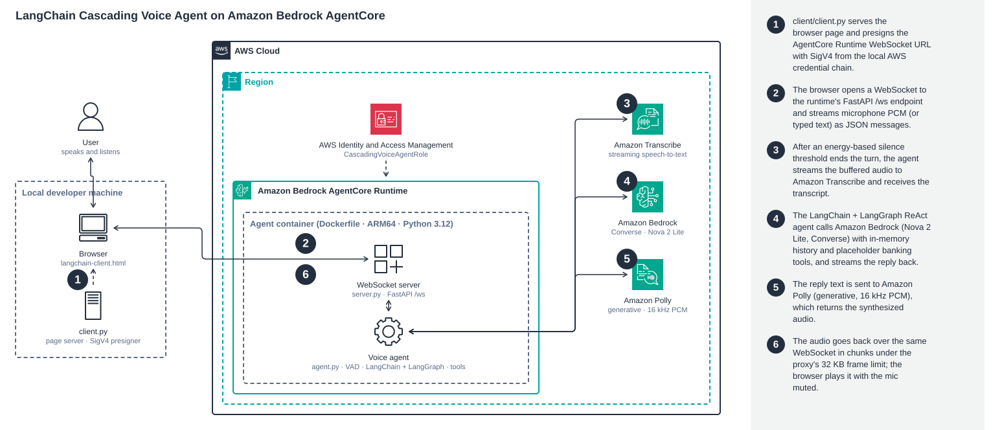

# LangChain Cascading Voice Agent on Amazon Bedrock AgentCore

A bidirectional voice agent built with the **cascading** ("sandwich") pattern —
**STT → Agent → TTS** — deployed to **Amazon Bedrock AgentCore Runtime**:

- **STT** — Amazon Transcribe (streaming)
- **Agent** — LangChain / LangGraph ReAct agent on **Amazon Bedrock Nova 2 Lite** (extended thinking)
- **TTS** — **Amazon Polly** (generative voices by default)

The browser client streams microphone audio over a WebSocket, through AgentCore's
managed proxy, to a FastAPI server that runs the pipeline and streams synthesized
audio back.



---

## 1. Problem & outcome

Speech-to-speech models (e.g. Nova Sonic) are the lowest-latency path to a voice
agent, but they lock you into one model's capabilities and voice set. The
**cascading** pattern trades some latency for **flexibility**: you can swap the STT,
LLM, or TTS component independently — for example, keep Amazon Transcribe + Polly
while changing only the reasoning model.

**Outcome:** a working, deployable voice agent where the reasoning layer is any
Bedrock text model wrapped in a LangChain agent, the voice is any Amazon Polly
voice, and the whole thing runs serverless on AgentCore Runtime.

## 2. Architecture & dependencies

```
Browser mic ──WebSocket──▶ AgentCore Runtime proxy ──▶ FastAPI server (server.py)
                                                          │
                                                          ├─ Amazon Transcribe  (STT: audio → text)
                                                          ├─ LangChain agent     (Nova 2 Lite: reasoning + tools)
                                                          └─ Amazon Polly        (TTS: text → audio)
Browser speakers ◀──WebSocket── synthesized PCM audio ◀───┘
```

| File | Purpose |
|------|---------|
| `websocket/server.py` | FastAPI server, IMDS credential refresh, `/ping` + `/invocations` + `/ws` endpoints |
| `websocket/agent.py` | WebSocket session loop, LangChain agent construction, energy-based VAD, STT/TTS pipeline |
| `websocket/Dockerfile` | `linux/arm64` Python 3.12 image AgentCore runs |
| `websocket/requirements.txt` | Server dependencies (FastAPI, LangChain, `amazon-transcribe`, boto3) |
| `client/client.py` | Local HTTP server that serves the HTML client and injects a SigV4 presigned WS URL |
| `client/langchain-client.html` | Browser voice/text client |
| `client/profiles.json` | Selectable agent personas (voice + system prompt) |
| `deployment/deploy.py` | Creates the IAM role, optional MCP Gateway, and launches the runtime |
| `deployment/cleanup.py` | Tears down the runtime, gateway, IAM role, and local state |
| `deployment/start_client.sh` | Generates the presigned URL and opens the client |
| `deployment/websocket_helpers.py` | SigV4 presigned URL generation |
| `deployment/agent_role.json` / `trust_policy.json` | IAM execution-role policy + trust policy |

**Runtime dependencies:** Amazon Bedrock (Nova 2 Lite — enable in *Model access*),
Amazon Transcribe (streaming), Amazon Polly, Amazon ECR + CodeBuild (build/host the
image), IAM. Nova 2 Lite is a cross-region inference profile — `us-east-1` works.

## 3. Setup, deploy & run

### Prerequisites

- Python 3.10+ and the AWS CLI, authenticated (`aws sts get-caller-identity` succeeds)
- Nova 2 Lite enabled in the Bedrock console (*Model access*)
- `jq` (used by `start_client.sh`)

### Deploy to AgentCore

```bash
cd text-to-speech/use-cases/cascading-voice-agent/langchain-agentcore-transcribe-polly

# Create an isolated environment for the deployment tooling.
# If .venv already exists from Python 3.9, remove it first:
# rm -rf .venv
/opt/homebrew/bin/python3.12 -m venv .venv
source .venv/bin/activate
python --version
python -m pip install --upgrade pip
python -m pip install -r deployment/requirements.txt

export ACCOUNT_ID=$(aws sts get-caller-identity --query Account --output text)
export AWS_REGION=us-east-1

# Build the image with CodeBuild (no local Docker) and launch the runtime
python deployment/deploy.py
```

`deploy.py` creates the `CascadingVoiceAgentRole` IAM role, builds/pushes the image,
launches the runtime, and writes `setup_config.json`. Add `--with-gateway` to also
create an MCP Gateway, or `--local-build` to build the image locally with Docker.

### Start the client

```bash
./deployment/start_client.sh
```

This reads `setup_config.json`, generates a SigV4 presigned WebSocket URL, and opens
the browser client. Pick a profile, allow microphone access, and start talking.

### Run locally (no AgentCore)

You can run the server on your machine and point the client at it directly:

```bash
# Terminal 1 — server
cd websocket
pip install -r requirements.txt
python server.py                       # listens on ws://localhost:8080/ws

# Terminal 2 — client
cd ../client
pip install -r requirements.txt
python client.py --ws-url ws://localhost:8080/ws
```

## 4. Sample inputs & expected outputs

Using the default **Finance Agent** profile:

| You say / type | Agent does |
|----------------|------------|
| "Hi, my name is Alex." | Greets you by name, asks to verify identity |
| "What's my account balance?" | Calls the `get_account_balance` tool, reads the balance aloud |
| "What are current mortgage rates?" | Calls `get_mortgage_rates`, responds in 2–3 sentences |

The agent's tools in `agent.py` (`get_account_balance`, `get_recent_transactions`,
`get_mortgage_rates`) return **placeholder** data — replace them with real
integrations (or MCP Gateway calls) for production.

## 5. Operational notes, IAM & data

- **IAM (sample policy):** `deployment/agent_role.json` grants the
  runtime `bedrock:InvokeModel*`, `polly:SynthesizeSpeech`, `transcribe:StartStreamTranscription`,
  CloudWatch Logs, X-Ray, ECR pull, and AgentCore workload-token access. Review and
  tighten before any non-sample use.
  In particular, the policy includes `"bedrock-agentcore:*"` with
  `"Resource": "*"`, granting full AgentCore access for sample convenience.
  Before testing in a shared environment or deploying to production, restrict
  the actions and resources to only those strictly necessary for this workload.
- **AgentCore WebSocket proxy quirks** (handled in the code):
  - The proxy echoes server-sent messages back; the server ignores its own message
    types (`tts_audio`, `agent_chunk`, `transcript`, `system`, `error`).
  - There is a ~32 KB per-frame limit, so TTS audio is chunked to stay under it.
  - The client mutes the mic during playback to avoid a TTS→STT feedback loop.
- **Data handling:** microphone audio is streamed to Amazon Transcribe and text to
  Bedrock/Polly. No audio is persisted by this sample. Conversation state is kept
  in-process (LangGraph `MemorySaver`) and lost when the session ends.
- **Latency:** STT → LLM → TTS run sequentially and the VAD adds a ~0.6 s silence
  threshold before processing.
- **Barge-in:** this sample does not implement interruption while Polly audio is
  playing. The client mutes the microphone during playback to avoid feedback, and
  the server treats each user turn as a full STT → agent → TTS cycle. Supporting
  barge-in would require keeping the mic open during playback, detecting new user
  speech, stopping in-flight audio, cancelling or draining any active agent/TTS
  work, and resuming the conversation with the interrupted context.

## 6. Validation

```bash
# Syntax-check the Python and shell sources
python3 -m py_compile websocket/*.py client/client.py deployment/*.py
bash -n deployment/start_client.sh
```

After deploying, `python deployment/deploy.py` prints the agent ARN and the
`/ping` health endpoint should report `Healthy`. Confirm end to end by speaking
through the client and hearing a Polly response.

## 7. Cleanup

```bash
python deployment/cleanup.py
```

Deletes the agent runtime, the MCP Gateway (if created), the `CascadingVoiceAgentRole`
IAM role, and the local `setup_config.json` / `gateway_config.json` state files.
The ECR repository created by the toolkit may need manual deletion if you want to
remove the stored image.

