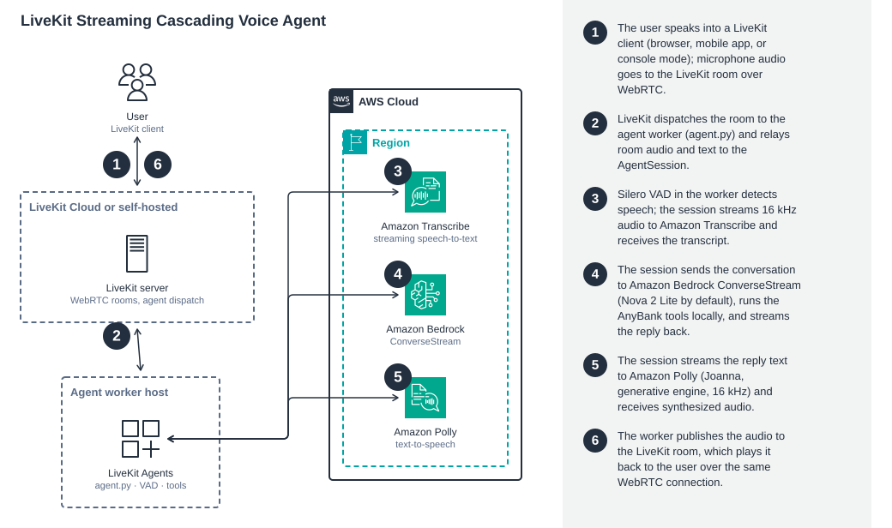

# LiveKit Streaming Cascading Voice Agent

A WebRTC voice agent built with **LiveKit Agents** and the LiveKit AWS plugin:

- **STT** — Amazon Transcribe Streaming
- **LLM** — Amazon Bedrock ConverseStream, defaulting to Nova 2 Lite
- **TTS** — Amazon Polly, streamed back through LiveKit media output

This variant is the most direct "streaming API" sample in this folder. LiveKit
owns room media, turn handling, interruption behavior, transcripts, and audio
playback while the AWS plugin owns the Transcribe, Bedrock, and Polly service
adapters.



## Files

| File | Purpose |
|------|---------|
| `agent.py` | LiveKit worker entrypoint and AnyBank sample tools |
| `assets/architecture.svg` | LiveKit, Amazon Transcribe, Amazon Bedrock, and Amazon Polly architecture |
| `requirements.txt` | LiveKit Agents AWS plugin and dotenv dependency |

## Prerequisites

- Python 3.10+
- AWS credentials with `transcribe:StartStreamTranscription`,
  `bedrock:InvokeModel*`, and `polly:SynthesizeSpeech`
- Bedrock model access for the configured model
- LiveKit Cloud or a self-hosted LiveKit server

Set these environment variables:

```bash
export AWS_ACCESS_KEY_ID=...
export AWS_SECRET_ACCESS_KEY=...
export AWS_DEFAULT_REGION=us-east-1

export LIVEKIT_URL=wss://your-project.livekit.cloud
export LIVEKIT_API_KEY=...
export LIVEKIT_API_SECRET=...
```

Optional knobs:

```bash
export BEDROCK_MODEL_ID=us.amazon.nova-2-lite-v1:0
export POLLY_VOICE_ID=Joanna
export POLLY_ENGINE=generative
export TRANSCRIBE_LANGUAGE=en-US
```

## Run Locally

```bash
cd text-to-speech/use-cases/cascading-voice-agent/livekit-streaming-transcribe-bedrock-polly
python -m venv .venv
source .venv/bin/activate
pip install -r requirements.txt

# Console mode is the quickest smoke test.
python agent.py console
```

## Cleaning Up

```bash
# Stop console mode with Ctrl+C.
deactivate

# Optional: remove the local virtual environment.
rm -rf .venv
```

Dispatch the agent into a room using your usual LiveKit workflow. You can pass
JSON job metadata to override the defaults:

```json
{
  "region": "us-east-1",
  "model": "us.amazon.nova-2-lite-v1:0",
  "voice": "Matthew",
  "language": "en-US",
  "system_prompt": "You are a concise retail banking voice assistant."
}
```

## Notes

- The sample tools return placeholder banking data. Replace them with your
  service integrations or MCP tools before using this beyond a demo.
- Keep responses short. Polly will read every generated token aloud, so concise
  system prompts make the experience feel faster.
- This sample targets LiveKit Cloud or self-hosted LiveKit.
