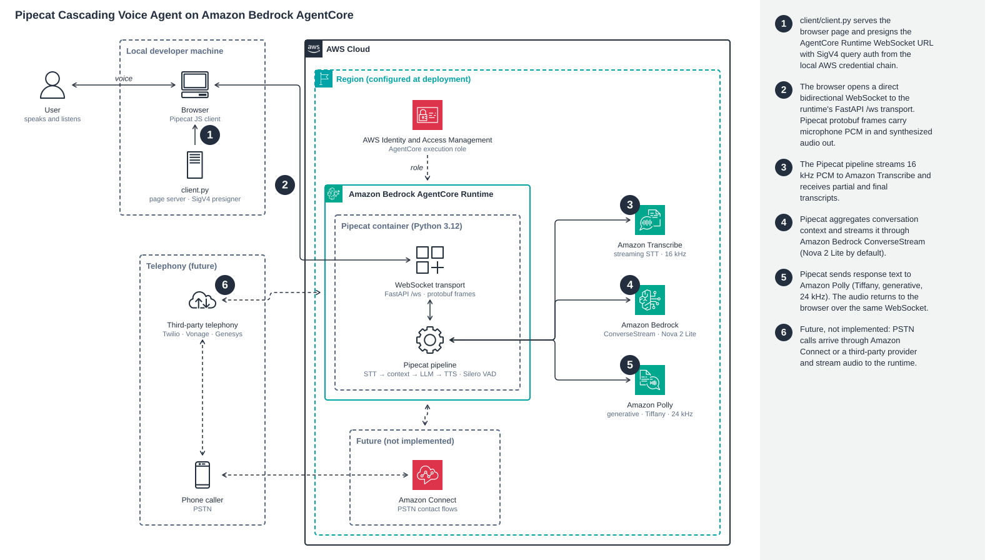

# Pipecat Cascading Voice Agent on Amazon Bedrock AgentCore

A deployable AgentCore Runtime sample for the **cascading** voice-agent pattern:

- **Transport** - AgentCore Runtime WebSocket
- **STT** - Amazon Transcribe Streaming
- **LLM** - Amazon Bedrock ConverseStream, defaulting to Nova 2 Lite
- **TTS** - Amazon Polly

This sample is the AgentCore counterpart to the local/Daily Pipecat runner in
`../pipecat-transcribe-bedrock-polly/`. It uses Pipecat's FastAPI WebSocket
transport with protobuf frame serialization, plus Pipecat AWS service processors
for Transcribe, Bedrock, and Polly.



## Architecture

```text
Browser Pipecat client in client/pipecat-client.html
  -> local helper server in client/client.py for page load and connection bootstrap
  -> SigV4 presigned AgentCore WebSocket URL
  -> direct bidirectional WebSocket to AgentCore Runtime
  -> Pipecat FastAPIWebsocketTransport at /ws
  -> AWSTranscribeSTTService
  -> AWSBedrockLLMService
  -> AWSPollyTTSService
  -> Pipecat FastAPIWebsocketTransport
  -> Browser speakers
```

The client-side pieces are local sample code in this repository:
`client/client.py` serves the browser page and generates a SigV4 presigned
AgentCore WebSocket URL, while `client/pipecat-client.html` loads the Pipecat
browser client and connects directly to AgentCore Runtime. Audio, transcripts,
bot responses, metrics, and output audio flow as Pipecat protobuf frames over
that direct WebSocket.

The connection bootstrap has three parts:

1. The browser asks `client/client.py` for a WebSocket connection endpoint.
2. `client/client.py` authenticates with AWS and signs the AgentCore Runtime
   WebSocket URL.
3. The browser opens a direct bidirectional WebSocket to AgentCore Runtime using
   that presigned URL.

The runtime runs with the AgentCore execution role created by
`deployment/deploy.py`, shown as a dashed link from IAM.

This sample wires no telephony at all: nothing in `websocket/`, `client/`, or
`deployment/` touches PSTN, Amazon Connect, Twilio, Vonage, or Genesys. The
diagram shows those pieces only as dashed lanes labelled `Telephony (future)`
and `Future (not implemented)`. A phone caller would reach the runtime either
through a third-party provider or through Amazon Connect; these are two
separate paths, not one chain. Treat both lanes as unbuilt.

## Files

| File | Purpose |
|------|---------|
| `websocket/server.py` | FastAPI app, AgentCore `/ping`, `/invocations`, and `/ws` endpoints |
| `websocket/bot.py` | Real Pipecat pipeline and AWS service processors |
| `websocket/Dockerfile` | AgentCore container image |
| `websocket/requirements.txt` | Runtime dependencies |
| `client/client.py` | Local helper that serves the browser client and signs AgentCore WebSocket URLs |
| `client/pipecat-client.html` | Browser Pipecat JS client that connects to the signed AgentCore WebSocket |
| `deployment/deploy.py` | Creates IAM role and deploys the runtime with the AgentCore starter toolkit |
| `deployment/cleanup.py` | Deletes runtime/IAM state created by the deployment |
| `deployment/start_client.sh` | Starts the browser client from `setup_config.json` |
| `assets/architecture.svg` | Architecture diagram (SVG; also editable in draw.io) |

## Deploy

Prerequisites:

- Python 3.12 recommended
- AWS CLI credentials
- Bedrock model access for the configured model
- `jq`

```bash
cd text-to-speech/use-cases/cascading-voice-agent/pipecat-agentcore-transcribe-bedrock-polly

/opt/homebrew/bin/python3.12 -m venv .venv
source .venv/bin/activate
python -m pip install --upgrade pip
python -m pip install -r deployment/requirements.txt

export ACCOUNT_ID=$(aws sts get-caller-identity --query Account --output text)
export AWS_REGION=us-east-1

python deployment/deploy.py
```

The deployment creates `PipecatCascadingVoiceAgentRole`, builds the runtime image
with CodeBuild by default, launches AgentCore Runtime, and writes
`setup_config.json`.

> **IAM warning:** `deployment/agent_role.json` includes
> `"bedrock-agentcore:*"` with `"Resource": "*"`, granting full AgentCore
> access for sample convenience. Before testing in a shared environment or
> deploying to production, restrict the actions and resources to only those
> strictly necessary for this workload.

Yes: this deploys the voice-agent runtime to **Amazon Bedrock AgentCore
Runtime**. The local browser client is only a helper for generating a signed
WebSocket URL and exercising the deployed runtime.

## Start The Client

```bash
./deployment/start_client.sh
```

The client opens a local web page, generates a presigned AgentCore WebSocket URL,
and connects with `@pipecat-ai/client-js` plus
`@pipecat-ai/websocket-transport`.

`start_client.sh` reuses `.venv` when it exists, or creates it when needed.

## Run Locally

```bash
cd text-to-speech/use-cases/cascading-voice-agent/pipecat-agentcore-transcribe-bedrock-polly/websocket
PYTHON_BIN=/opt/homebrew/bin/python3.12
$PYTHON_BIN -m venv ../.venv
source ../.venv/bin/activate
python --version
python -m pip install --upgrade pip
python -m pip install -r requirements.txt
python server.py
```

Then in another terminal:

```bash
cd ../client
source ../.venv/bin/activate
python -m pip install -r requirements.txt
python client.py --ws-url ws://localhost:8080/ws
```

## Runtime Configuration

Environment variables:

```bash
export BEDROCK_MODEL_ID=us.amazon.nova-2-lite-v1:0
export POLLY_VOICE_ID=Tiffany
export POLLY_ENGINE=generative
export AUDIO_INPUT_SAMPLE_RATE=16000
export AUDIO_OUTPUT_SAMPLE_RATE=24000
export AUDIO_OUT_10MS_CHUNKS=4
export TRANSCRIBE_LANGUAGE=en-US
export BEDROCK_MAX_TOKENS=512
export BEDROCK_TEMPERATURE=0.4
```

Runtime configuration is currently environment-variable based. Per-session
configuration over the Pipecat client protocol is a later extension.

## Validation

```bash
python3 -m py_compile websocket/*.py client/client.py deployment/*.py
bash -n deployment/start_client.sh
```

## Cleanup

```bash
python deployment/cleanup.py
```

## Notes

- This sample uses the WebSocket transport recommended for the simplest
  AgentCore prototype path. WebRTC/TURN/telephony transports can be added later
  for richer production media scenarios.
- The runtime container is ARM64, matching AgentCore Runtime requirements.
- The browser imports Pipecat client packages from an ESM CDN for a lightweight
  self-contained sample. For production, bundle those packages with your normal
  frontend build.
