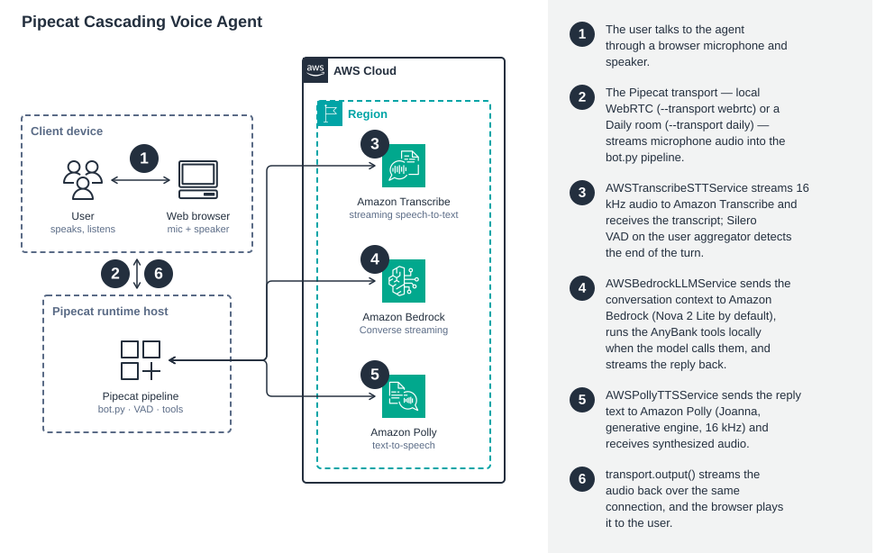

# Pipecat Cascading Voice Agent

A Pipecat botfile using the standard cascading pipeline:

```text
transport input -> Amazon Transcribe -> Amazon Bedrock -> Amazon Polly -> transport output
```

This version keeps the code close to Pipecat's normal service-adapter API. It is
a good starting point when you want Pipecat's transport flexibility and pipeline
composition without the LiveKit room/job model.



## Files

| File | Purpose |
|------|---------|
| `bot.py` | Pipecat runner entrypoint, STT/LLM/TTS pipeline, and placeholder tools |
| `requirements.txt` | Pipecat AWS, Daily/WebRTC runner, Silero VAD, dotenv |

## Prerequisites

- Python 3.11+
- AWS credentials with `transcribe:StartStreamTranscription`,
  `bedrock:InvokeModel*`, and `polly:SynthesizeSpeech`
- Bedrock model access for the configured model
- For Daily transport: `DAILY_API_KEY`

Set these environment variables:

```bash
export AWS_ACCESS_KEY_ID=...
export AWS_SECRET_ACCESS_KEY=...
export AWS_REGION=us-east-1
```

Optional knobs:

```bash
export BEDROCK_MODEL_ID=us.amazon.nova-2-lite-v1:0
export POLLY_VOICE_ID=Joanna
export POLLY_ENGINE=generative
export TRANSCRIBE_LANGUAGE=en-US
```

You can set `BEDROCK_LATENCY=standard` or `BEDROCK_LATENCY=optimized` for
models and Regions that support Bedrock latency performance configuration. The
sample leaves it unset by default because some models, including the default
Nova 2 Lite model in `us-east-1`, reject that setting.

## Run Locally

```bash
cd text-to-speech/use-cases/cascading-voice-agent/pipecat-transcribe-bedrock-polly
python -m venv .venv
source .venv/bin/activate
pip install -r requirements.txt

# Uses Pipecat's local WebRTC runner.
python bot.py --transport webrtc
```

The Pipecat runner prints a local client URL when it starts. Open it in a
browser, allow microphone access, and talk to the bot.

For Daily:

```bash
export DAILY_API_KEY=...
python bot.py --transport daily
```

## Cleaning Up

```bash
# Stop the local runner with Ctrl+C.
deactivate

# Optional: remove the local virtual environment.
rm -rf .venv
```

## Notes

- The pipeline uses Pipecat's current universal LLM context and AWS service
  adapters instead of hand-written AWS event loops. That keeps the sample compact
  while still using Amazon Transcribe, Amazon Bedrock, and Amazon Polly
  throughout the cascade.
- The agent has three placeholder banking tools (`get_account_balance`,
  `get_recent_transactions`, `get_mortgage_rates`), defined as Pipecat
  `FunctionSchema`s and registered with `llm.register_function`. Bedrock decides
  when to call them, and the handlers run in the bot process. They return fake
  data; replace them with your service integrations or MCP tools before using
  this beyond a demo.
- It targets Pipecat local/Daily/WebRTC execution, not AgentCore Runtime.
