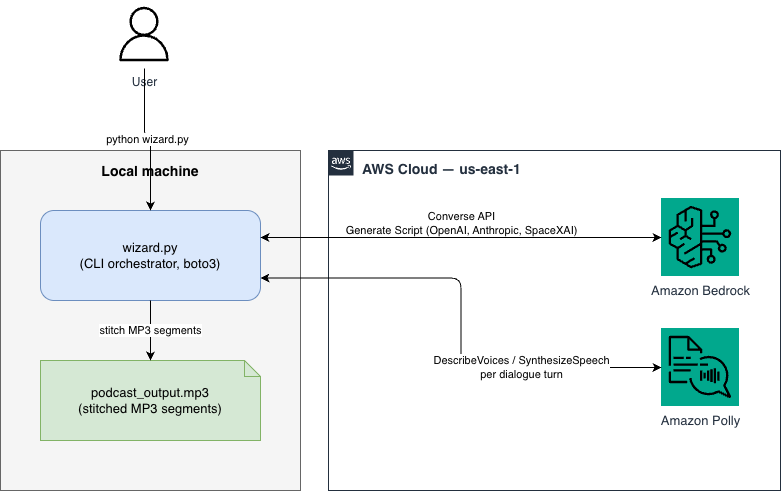

# Two-Speaker Podcast Generator

Generate a short host/co-host podcast from a topic with one interactive command.
Amazon Bedrock writes the script, Amazon Polly gives each speaker a selected
voice, and the sample joins the turns into one MP3.

Use this sample when you want a focused, local example of script generation,
voice discovery, multi-voice synthesis, and basic usage reporting without
deploying AWS resources.

## Requirements and permissions

You need Python 3.10 or later, AWS credentials, access to one of the configured
Bedrock models, and these permissions:

```json
{
  "Version": "2012-10-17",
  "Statement": [
    {
      "Effect": "Allow",
      "Action": [
        "polly:DescribeVoices",
        "polly:SynthesizeSpeech"
      ],
      "Resource": "*"
    },
    {
      "Effect": "Allow",
      "Action": "bedrock:InvokeModel",
      "Resource": [
        "arn:aws:bedrock:*::foundation-model/*",
        "arn:aws:bedrock:*:*:inference-profile/*",
        "arn:aws:bedrock:*:*:project/default"
      ]
    }
  ]
}
```

The sample uses boto3's standard credential chain. A named AWS IAM Identity
Center profile is optional. The AWS Region is pinned to `us-east-1` in
`config.py` for the required Polly generative voices.

## Setup and run

The commands below use Python 3.12; substitute another installed Python 3.10+
executable if needed.

```bash
cd text-to-speech/use-cases/content-to-audio/two-speaker-podcast
python3.12 --version
python3.12 -m venv .venv
source .venv/bin/activate       # Windows PowerShell: .venv\Scripts\activate
pip install -r requirements.txt
python wizard.py
```

To use a named profile:

```bash
aws sso login --profile my-aws-profile
python wizard.py --profile my-aws-profile
```

The wizard asks for a topic, model, speaking style, host and co-host voices,
and output filename. A blank topic lets the selected model choose one.

## Architecture



```text
User → wizard.py → Bedrock Converse → validated dialogue
                  → Polly synthesis per speaker → local MP3
```

The sample creates no remote infrastructure. It only invokes Bedrock and Polly
APIs and writes the resulting audio locally.

## Models, styles, and voices

The Bedrock model choices are configured in `config.py`:

| Label | Inference profile |
| --- | --- |
| GPT-5.6 Luna | `global.openai.gpt-5.6-luna` |
| Claude Sonnet 5 | `global.anthropic.claude-sonnet-5` |
| Grok 4.6 | `global.xai.grok-4.6` |

The script parser requires exactly four alternating `host` and `cohost` turns.

| Style | Polly engine | Input | Voices |
| --- | --- | --- | --- |
| Conversational | `generative` | Plain text | Live roster from `DescribeVoices` |
| Newscaster | `neural` | Newscaster SSML | Amy, Joanna, Matthew, and Lupe |

The wizard fetches the current generative voice roster on every run.
Newscaster-compatible voices are configured explicitly because that capability
is not returned by `DescribeVoices`.

## Output and usage

The selected output name is written as an MP3 in the current directory. The
final summary reports Bedrock input/output tokens and Polly billable characters
returned by the APIs. Apply current
[Amazon Bedrock pricing](https://aws.amazon.com/bedrock/pricing/) and
[Amazon Polly pricing](https://aws.amazon.com/polly/pricing/) if you need a
currency estimate.

## Customize

- Edit `config.py` for models, Region, turn count, voices, and audio settings.
- Edit `podcast_script.build_prompt()` for language, tone, and format.
- Extend `podcast_generation.synthesize()` for different audio handling.

The current role contract is fixed to `host` and `cohost`; supporting more
speakers requires updating the prompt, voice selection, and synthesis mapping.

## Project layout

| File | Responsibility |
| --- | --- |
| `wizard.py` | Interactive entry point and orchestration |
| `config.py` | Models, Region, engines, voices, and output settings |
| `podcast_script.py` | Bedrock prompt, Converse call, and script validation |
| `podcast_generation.py` | Voice discovery, Polly synthesis, and MP3 assembly |

## Cleanup

Delete the generated MP3 when it is no longer needed. The sample creates no
remote resources.

[Back to Content-to-Audio Use Cases](../README.md)
