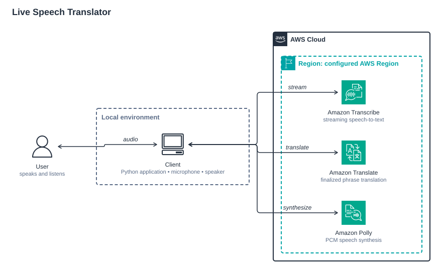
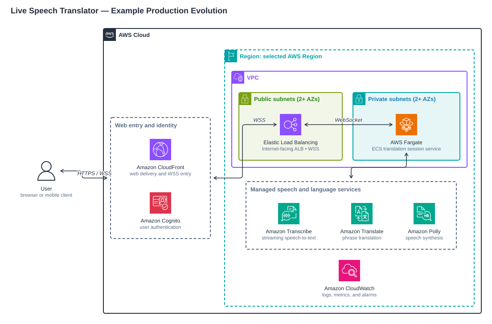

# Live Speech Translator

A foundational local sample that translates finalized spoken phrases and plays
them through Amazon Polly.

The sample runs on one developer machine and creates no cloud infrastructure.
It demonstrates the service integration rather than a conversational agent:
there is no LLM, dialogue state, or tool use.

## Architecture



- **Transcribe** converts 16 kHz microphone PCM into finalized transcripts.
- **Translate** translates each final phrase. If Transcribe does not return a
  detected language, the fallback uses Translate source-language autodetection
  and Amazon Comprehend.
- **Polly** synthesizes the translation as 16 kHz PCM for local playback.
- A bounded queue provides basic backpressure between transcription and
  translation.

Example console output:

```text
heard [ja]: お元気ですか？
en: How are you?
```

## Quick Start

You need Python 3.10 or newer, working microphone and speaker access, AWS
credentials, and permission to call Transcribe, Translate, and Polly.

```bash
cd text-to-speech/use-cases/live-speech-translator
python3 -m venv .venv
source .venv/bin/activate
pip install -r requirements.txt
aws sso login                  # or use your normal AWS credential flow
python app.py --check
```

`si` mode keeps the microphone active while translated speech plays.
`half-duplex` sends silence to Transcribe during playback and is better suited
to open speakers.

Use headphones in the default simultaneous interpretation mode to prevent
playback feedback.

```bash
python app.py --source auto --target en --voice Tiffany --mode si
```

List and select audio devices:

```bash
python app.py --list-devices
python app.py --input-device 1 --output-device 4
python app.py --input-device "USB Microphone" --output-device "USB Headset"
```

Common variations:

```bash
python app.py --source ja-JP --target en --voice Tiffany
python app.py --source es-US --target en --voice Matthew
python app.py --target es --voice Lupe --voice-language es-US --engine neural
python app.py --mode half-duplex
python app.py --help
```

The sample defaults to Polly's generative engine with the `Tiffany` US English
voice. `Matthew` is another US English generative voice demonstrated above.
When changing the target language, choose a matching Polly voice and
`--voice-language`. Use `half-duplex` with open speakers; it sends silence to
Transcribe while Polly audio is playing.

With `--source auto`, keep `translator.auto_language_options` in
[`config.yaml`](config.yaml) focused. A shorter list improves language
identification speed and accuracy.

## Configuration

Defaults are stored in [`config.yaml`](config.yaml). Command-line options
override them for one run.

| Option | Example | Description |
| --- | --- | --- |
| `--config` | `--config config.yaml` | Load a different configuration file |
| `--region` | `--region us-west-2` | Select the AWS Region |
| `--source` | `--source ja-JP` | Set a Transcribe locale or use `auto` |
| `--target` | `--target en` | Set the Translate target language |
| `--voice` | `--voice Matthew` | Select a Polly voice |
| `--voice-language` | `--voice-language en-US` | Set the Polly voice language |
| `--input-device` | `--input-device 1` | Select a microphone by index or name |
| `--output-device` | `--output-device 4` | Select a speaker by index or name |
| `--engine` | `--engine generative` | Select the Polly engine |
| `--mode` | `--mode half-duplex` | Select `si` or `half-duplex` playback |
| `--check` | `--check` | Validate local and AWS configuration |
| `--list-devices` | `--list-devices` | List available audio devices and exit |
| `--help` | `--help` | Display all command-line options |

## IAM and Data Handling

Use the standard AWS credential chain. Do not place credentials in source code,
configuration files, browser clients, or mobile applications.

Least-privilege actions for the local sample:

```json
{
  "Version": "2012-10-17",
  "Statement": [
    {
      "Effect": "Allow",
      "Action": [
        "transcribe:StartStreamTranscription",
        "translate:TranslateText",
        "polly:SynthesizeSpeech",
        "polly:DescribeVoices",
        "comprehend:DetectDominantLanguage"
      ],
      "Resource": "*"
    }
  ]
}
```

`polly:DescribeVoices` is needed only for `--check`.
`comprehend:DetectDominantLanguage` is needed only for the Translate
source-language autodetection fallback.

Do not retain audio or transcripts without explicit user consent. Production
implementations should use separate client identities and server-side roles.

## Example Production Evolution

The runnable code remains local. The following diagram shows one possible
production evolution, not a prescriptive or universally preferred design.



In this example, CloudFront and Cognito provide the web entry and user identity,
an internet-facing Application Load Balancer spans public subnets, and an ECS
service on AWS Fargate maintains translation sessions in private subnets across
Availability Zones. Fargate calls the managed AWS services through an outbound
networking approach appropriate for the workload, such as NAT, VPC endpoints,
or another approved pattern.

Adapt the compute, networking, authentication, scaling, and observability
choices to the workload. Consider message validation, WSS-only communication,
autoscaling, connection draining, latency and queue-depth alarms, and explicit
consent before retaining audio or transcripts.

## Troubleshooting

| Symptom | What to try |
| --- | --- |
| Unsupported Polly voice or engine | Run `python app.py --check`, then choose a compatible voice, language, and engine |
| Language labels do not switch | Pause between phrases and narrow `auto_language_options` |
| The app translates its own playback | Use headphones or `--mode half-duplex` |
| Wrong microphone or speaker | Run `python app.py --list-devices`, then select the devices explicitly |
| PortAudio or `sounddevice` error | Verify OS audio permissions and reinstall PortAudio/`sounddevice` |
| Live transcription fails after preflight | Confirm Transcribe permissions, Region availability, and microphone access |

## Cleanup

Stop the process with `Ctrl+C`. No cloud infrastructure is created. Delete the
local virtual environment if desired.
