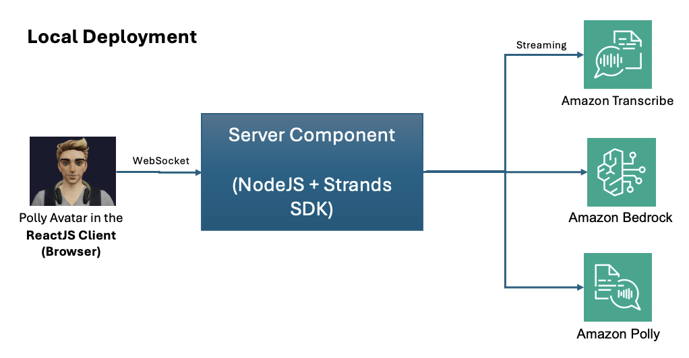

# Polly Avatar Demo

## 1. Introduction

The Polly Avatar Demo is a conversational 3D avatar that listens, thinks, and
speaks back with real-time lip-sync. You talk to it through your microphone; it
transcribes your speech, generates a reply with a large language model, speaks
the reply aloud, and animates a 3D character's mouth in sync with the audio.

The demo exists to showcase **Amazon Polly**, and in particular the Polly
features that make believable lip-sync possible:

- **Viseme speech marks** — alongside the synthesized audio, Polly returns a
  timed stream of *visemes* (mouth-shape phonemes such as `p`, `a`, `sil`).
  These timings drive the avatar's mouth so it matches the spoken audio. This
  is the central feature the demo is built around.
- **Neural text-to-speech** — natural-sounding neural voices. (The neural,
  long-form, and standard engines support visemes; the generative engine does
  not, so the demo uses the neural engine.)
- **`SynthesizeSpeech` streaming** — low-latency synthesis, called per sentence
  so speech begins while the rest of the reply is still being generated.
- **SSML for expressive speech** — the agent lightly marks up its replies with
  neural-safe SSML (`<break>` for pauses, `<prosody rate/volume>` for pace and
  loudness, `<say-as>` for numbers and dates) so speech sounds more natural.
  Markup is validated against a neural-safe allowlist and falls back to plain
  text if anything is off, so a bad tag never silences a sentence.
- **Multi-language, multi-voice `DescribeVoices`** — the available languages
  and voices are queried from Polly, and the demo lets you switch voice and
  language mid-conversation.

It pairs Polly with **Amazon Transcribe** (streaming speech-to-text) and a
conversational agent built on the **Strands Agents SDK** over **Amazon Bedrock**
to close the full speech-to-speech loop.

Other things the demo shows off:

- **Persona-driven agent** — the avatar has a name and a warm, lightly humorous
  personality (the assistant takes on the selected avatar's name) with
  guardrails, built with the Strands Agents TypeScript SDK. It also knows about
  this demo, so you can ask it what features it has or how it works.
- **Natural turn-taking and barge-in** — interrupt the avatar just by speaking
  (or say "stop"); the agent decides whether what you said is a real
  interruption or just backchannel like "mm-hmm" (which it ignores and keeps
  talking through). If it gets cut off, it can pick up where it left off when
  you say "go on".
- **Persistent conversation memory** — the agent remembers the conversation
  across page reloads and reconnects, using the Strands SDK's local-file session
  store (keyed by a per-browser id).
- **Switch avatar, voice, and language mid-conversation** — without ending the
  session; voice changes even re-synthesize the current reply on the fly.
- **Gender-aware voices** — the voice list is filtered to the avatar's gender.
- **Live transcript highlighting** — the sentence being spoken is highlighted in
  the conversation panel, synced to the audio.

## 2. Tech stack

| Layer         | Technology                                          |
| ------------- | --------------------------------------------------- |
| Front end     | React + Vite + TypeScript                           |
| 3D rendering  | Three.js + @react-three/fiber + @react-three/drei   |
| Audio         | Web Audio API                                       |
| Back end      | Node.js + TypeScript + `ws` (WebSocket)             |
| Speech-to-text| Amazon Transcribe Streaming                         |
| Agent / LLM   | Strands Agents SDK over Amazon Bedrock (Claude Sonnet 4.6) |
| TTS + visemes | Amazon Polly (neural engine)                        |
| Auth          | Amazon Cognito (Hosted UI, enforced in the cloud)   |
| Infra         | AWS CDK (Fargate, ALB, CloudFront, Cognito, WAF)    |

## 3. Architecture

### Diagram

The two ways to run the demo have different deployment shapes — local mode
talks to AWS services directly, while the AWS deployment fronts everything
with CloudFront, WAF, and Cognito. Both share the same core loop: the
browser's WebSocket connection drives a Node server that orchestrates
Transcribe, Bedrock, and Polly.

**Local deployment** — the client connects straight to the local server
process, which calls the AWS services directly with your local credentials.



**AWS deployment** — the same server runs on ECS behind an ALB, with
CloudFront (and WAF) as the single public front door for both the static
client (served from S3) and the WebSocket connection (proxied to the ALB),
and Cognito gating access.


### Walkthrough

1. **Capture.** The browser captures microphone audio and streams PCM chunks to
   the server over a single WebSocket.
2. **Transcribe (STT).** The server forwards the audio to Amazon Transcribe
   streaming and receives partial transcripts (for the live caption) and final
   transcripts. A final transcript arriving while the avatar is talking is
   evaluated as a possible **barge-in** (see "Turn-taking and barge-in" below).
3. **Agent (LLM).** The final transcript is sent to a per-session Strands agent
   (`server/src/services/pollyAgent.ts`) that runs on Amazon Bedrock. The agent
   carries the avatar's persona and guardrails and owns the conversation
   history. Its reply streams back token by token and is split into sentences
   as it arrives.
4. **Polly (TTS + visemes).** Each sentence is synthesized with Amazon Polly.
   Because a synthesis call returns either audio *or* speech marks (not both),
   the server makes two calls per sentence — one for the MP3 audio and one for
   the viseme speech marks — then sends both to the client tagged with a
   `sentenceIndex`.
5. **Playback + lip-sync.** The client queues each sentence's audio, plays it
   through the Web Audio API, and uses the viseme timings to drive the avatar's
   mouth every frame. The `sentenceIndex` on each chunk lets the UI highlight
   the sentence currently being spoken and lets the server resume from the right
   sentence when the voice is changed mid-reply.

### The conversational agent

The LLM turn runs through the **Strands Agents SDK**
(`server/src/services/pollyAgent.ts`), not a raw Bedrock call. Each WebSocket
session gets its own `Agent` instance, which:

- carries a **"Polly Assistant" persona** whose name is the selected built-in
  host's name — warm and lightly humorous, and aware of what this demo is,
- applies lightweight **guardrails** (stay helpful and on-topic, keep replies
  short and speakable, decline professional advice and harmful content, no
  claims of real-time data or actions),
- lightly marks up replies with **neural-safe SSML** for expressive speech (the
  server validates the markup and falls back to plain text if it isn't safe —
  see `server/src/services/ssml.ts`), and
- owns the **conversation history** across turns, optionally **persisted** to a
  local-file session store so it survives reloads/reconnects.

Switching avatars mid-session updates the persona name in place while keeping
history; `BEDROCK_MODEL_ID` selects the underlying model (Claude Sonnet 4.6 by
default).

**Turn-taking and barge-in.** The user can interrupt at any time. A final
transcript that arrives while the avatar is talking is first screened cheaply
(pure filler like "mm-hmm" is ignored; short commands like "stop" always count),
then the agent itself decides whether it's a real interruption or just
backchannel — so the avatar only stops when there's genuinely something to
respond to. When it is interrupted, the server tracks what was actually spoken
versus what was cut off, so the agent can resume ("go on") without repeating
itself. Transcript classification lives in
`server/src/services/transcriptClassifier.ts`.

**Persistent memory.** When the client supplies a stable session id (stored per
browser), the agent is backed by the Strands SDK's `SessionManager` over a
local-file store (under `server/.sessions/` by default, configurable with
`SESSION_STORE_DIR`). It restores prior history on the first turn and auto-saves
after each turn. Without a session id, the agent is in-memory only for the life
of the WebSocket connection.

### Lip-sync: one interface, one driver

Lip-sync is applied every frame through a common `VisemeDriver` interface
(`client/src/avatar/VisemeDriver.ts`), kept as its own abstraction for
architectural clarity even though there's currently a single implementation:

- **`AnimationClipDriver`** (`HostModel`) — for the built-in "host" characters.
  It cross-fades one animation clip per Polly viseme.

### Repository layout

```
client/    React + Vite + Three.js front end
  src/
    components/   React UI (canvas, controls, conversation, login)
    hooks/        WebSocket, audio capture/playback, auth
    avatar/       3D host rendering + viseme driver + host catalog
    utils/        viseme debug-display data (descriptions, openness, roundedness)
server/    Node + TypeScript WebSocket server
  src/          runtime code: index.ts + services/ (transcribe, pollyAgent, polly,
                ssml, transcriptClassifier, auth)
  scripts/      dev utilities (language generation, service smoke tests)
shared/    Types shared between client and server
infra/     AWS CDK app (one stack: Network / Auth / Backend / Frontend constructs)
```

## 4. How to run it

The application runs in two modes. **Local** mode needs no AWS infrastructure —
only AWS credentials so the server can call the AI services. **AWS** mode
deploys the whole stack (auth, container service, CDN) with one command.

> AWS-specific values (account IDs, Cognito IDs, CloudFront domain) are never
> committed. Locally none are needed; when deploying, CloudFormation passes them
> to the server container, which serves them to the browser as `/config.json`.

### 4a. Run locally

**Prerequisites**

- Node.js 20+
- AWS credentials configured in your environment, with permission to call
  Amazon Transcribe, Amazon Bedrock, and Amazon Polly. See the
  [AWS CLI configuration guide](https://docs.aws.amazon.com/cli/latest/userguide/cli-chap-configure.html)
  (`aws configure`, SSO, or environment variables all work).
- Amazon Bedrock model access enabled for the configured model in your account
  (see [Manage Amazon Bedrock model access](https://docs.aws.amazon.com/bedrock/latest/userguide/model-access.html)).

**Steps**

```bash
# 1. Start the server (WebSocket on :8080, auth disabled)
cd server
npm ci
cp ../.env.example .env       # optional: adjust region / model / voice
# AUTH_ENABLED defaults to true (fail-closed); disable it for local dev:
AUTH_ENABLED=false npm run dev

# 2. Start the client (in a second terminal)
cd client
npm ci
npm run dev                   # open http://localhost:5173
```

The commands use `npm ci`, which installs exactly the versions pinned in each
`package-lock.json`. Use `npm install` only when you add or upgrade a
dependency, and commit the updated lock file.

The client's local defaults live in `client/.env.development`
(`VITE_AUTH_ENABLED=false`); it connects to the local server at
`ws://localhost:8080`. No AWS-specific configuration is required or stored
locally.

Server environment variables (see `.env.example`):

| Variable           | Default                          | Purpose                             |
| ------------------ | -------------------------------- | ----------------------------------- |
| `AWS_REGION`       | `us-east-1`                      | Region for AWS service clients      |
| `BEDROCK_MODEL_ID` | `us.anthropic.claude-sonnet-4-6` | Bedrock model / inference profile   |
| `POLLY_VOICE_ID`   | `Matthew`                        | Default Polly voice                 |
| `POLLY_ENGINE`     | `neural`                         | Polly engine (must support visemes) |
| `PORT`             | `8080`                           | WebSocket server port               |
| `AUTH_ENABLED`     | `true`                           | Set to `false` for local dev        |
| `SESSION_STORE_DIR`| `server/.sessions`               | Where persisted conversations are stored |

The client's language and voice picker reads `client/public/languages.json`.
To refresh it when Polly adds voices:

```bash
cd server
npm run gen:languages    # regenerates client/public/languages.json from Polly
```

### 4b. Host it in AWS

> **Sample code, not production-ready.** Read the
> [deployment security notice](infra/README.md#deployment-security-and-non-production-notice)
> for what it does and does not protect before deploying.

The CDK app deploys a single stack, `PollyAvatar`, in one pass: the VPC and
endpoints, the Cognito user pool and Hosted UI, the ARM64 Fargate service
behind an ALB locked to CloudFront, and the CloudFront distribution (with WAF)
serving the SPA from S3. Auth is enforced in the cloud, and cdk-nag checks the
stack on every deploy.

**Prerequisites**

- AWS credentials for the target account, with permission to call Amazon
  Transcribe, Amazon Bedrock, and Amazon Polly (the Fargate task role is scoped
  to these at deploy time), plus permission to create the infra resources.
- Amazon Bedrock model access enabled for the configured model in the account.
- A container runtime — [Finch](https://runfinch.com/) or Docker — for building
  the Fargate image.
- A one-time CDK bootstrap of the account/region (run from `infra/` after
  `npm ci`): `cd infra && npm ci && npx cdk bootstrap`.

**Steps**

1. Deploy the infrastructure:

   ```bash
   cd infra
   npm run deploy        # Finch users: `finch vm start && export CDK_DOCKER=finch` first
   ```

2. Upload the frontend. List the stack outputs and copy `SiteBucketName` and
   `DistributionId`:

   ```bash
   aws cloudformation describe-stacks --stack-name PollyAvatar --query "Stacks[0].Outputs[].{OutputKey:OutputKey,OutputValue:OutputValue}" --output table
   ```

   Then run:

   ```bash
   cd ../client          # from infra/, where step 1 left you
   npm ci
   npm run build
   aws s3 sync dist s3://<SiteBucketName> --delete
   aws cloudfront create-invalidation --distribution-id <DistributionId> --paths "/*"
   ```

   Repeat step 2 whenever the client changes.

> Deploys to `us-east-1` by default. The CloudFront WAF web ACL must live in
> `us-east-1`, so the whole app is kept there for simplicity. To use another
> region, set `CDK_DEFAULT_REGION` before running and make sure Bedrock model
> access is enabled there.

`npm run deploy` builds the server image and deploys the `PollyAvatar` stack
in a single pass, with no Lambda functions. The frontend upload is a manual
`aws s3 sync` (step 2) because CDK's S3 upload helper is a Lambda. The client
build has no account-specific values: CloudFront routes `/config.json` to the
server, which returns this deployment's Cognito settings. The stack outputs
include the **app URL** (`AppUrl`) and the **UserPoolId**. See
[infra/README.md](infra/README.md#2-upload-the-frontend) for details.

> Upgrading a deployment made with the old `deploy.sh`? Delete the four old
> `PollyAvatar-*` stacks first; see
> [infra/README.md](infra/README.md#upgrading-a-deployment-made-with-deploysh-one-time).

**Create a user before signing in.** The deploy creates no users, so no
credentials end up in CloudFormation. Add one in the Cognito console (User
pools → `polly-avatar-users` → Create user) or with the CLI:

```bash
aws cognito-idp admin-create-user \
  --user-pool-id <UserPoolId> \
  --username you@example.com \
  --user-attributes Name=email,Value=you@example.com Name=email_verified,Value=true
```

Cognito emails a temporary password to that address; you'll set your own on
first login. See [infra/README.md](infra/README.md#creating-users-required-before-first-sign-in)
for details.

## 5. Cleanup

To avoid ongoing charges, tear down all AWS resources created by the deploy:

```bash
cd infra
npm run destroy
```

This deletes the CloudFront distribution, Fargate service, ALB, VPC, and the
Cognito user pool (including its users). **Three S3 buckets are left behind
on purpose**: the site bucket and the two access-log buckets. Emptying a bucket
during stack delete needs a CDK helper Lambda, and this app deliberately has
none. The cost is a few cents a month.

To remove them, empty and delete the three `pollyavatar-…` buckets in the S3
console (**Empty** handles the old object versions). See
[infra/README.md](infra/README.md#tear-down) for the lookup command.

Locally, no cleanup is needed — stop the `npm run dev` processes.

---

### Notes

- Polly's **generative** engine and bidirectional streaming API do **not** emit
  viseme speech marks, so this demo uses the **neural** engine with
  `SynthesizeSpeech`, which returns both audio and visemes.
- Because it stays on the neural engine (for visemes), the demo only uses
  **neural-safe SSML** — `<break>`, `<prosody rate/volume>`, `<say-as>`, and a
  few structural tags. Standard-engine-only effects such as
  `<amazon:effect name="whispered">` and `<amazon:breath>`, and neural-unsupported
  tags like `<emphasis>` and prosody `pitch`, are intentionally not used (they'd
  throw or be ignored on neural). The allowlist is enforced in
  `server/src/services/ssml.ts`.
- The built-in host characters are **Amazon Sumerian Hosts**; see
  `client/public/hosts/ATTRIBUTION.md` for asset attribution and licensing.

## Security

See [CONTRIBUTING](CONTRIBUTING.md#security-issue-notifications) for more information.

## License

This library is licensed under the MIT-0 License. See the [LICENSE](LICENSE.txt) file.

The built-in 3D host characters (Amazon Sumerian Hosts, under `client/public/hosts/`)
are licensed separately under CC BY-SA 4.0; see
[ATTRIBUTION.md](client/public/hosts/ATTRIBUTION.md).
