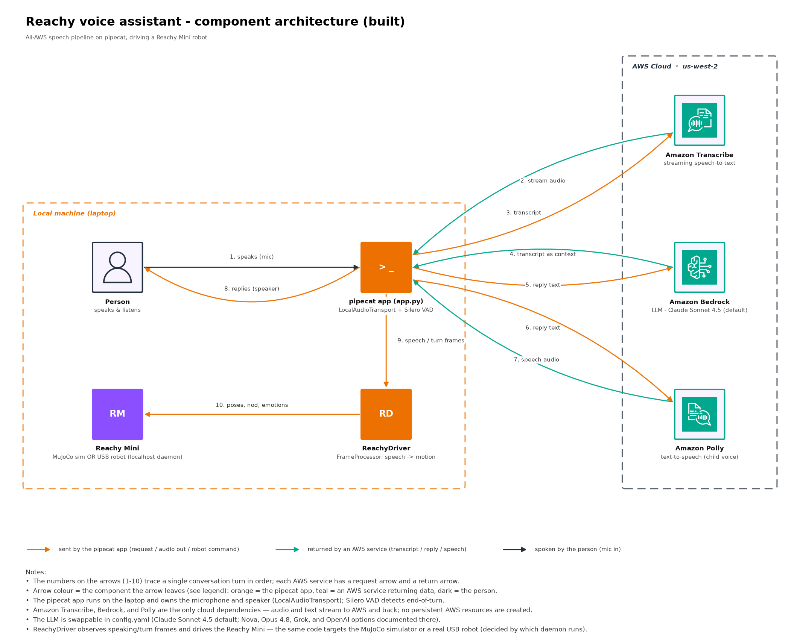

# Reachy Mini voice assistant (all-AWS)

A real-time spoken voice assistant that lives inside a
[Reachy Mini](https://www.pollen-robotics.com/) desk robot: it listens on the
local mic, thinks with Amazon Bedrock, speaks through the local speaker, and
moves the robot's head so the conversation feels embodied.

English-only by design. It does **not** use Amazon Translate (single language)
or Amazon Nova Sonic (speech-to-speech, which would replace Transcribe + Polly
rather than sit alongside them) — see §11.

## Quick start

Wait for the robot to finish before you speak — the mic is ignored while it
talks, to keep it from hearing itself (§4). From
`use-cases/reachy-voice-assistant/`:

```bash
brew install portaudio                     # macOS, once (PyAudio needs it)
python3.12 -m venv .venv && source .venv/bin/activate
pip install -r requirements.txt            # full app (deps pinned here)
aws sso login                              # or your org's login
# One-time: enable your Bedrock model in the console -> Model access
python app.py --check                      # preflight: imports, region, creds
python app.py --robot fake                 # no hardware — talk to it, Ctrl-C to stop
```

Then add a robot: a daemon in one terminal, the app in another. Sim vs. real is
decided by *which daemon runs* — the `app.py` command is identical.

```bash
# terminal 1 — pick ONE daemon
reachy-mini-daemon                                            # real Lite (USB)
mjpython -m reachy_mini.daemon.app.main --sim --scene minimal  # simulator

# terminal 2
source .venv/bin/activate
python app.py --robot reachy
```

Defaults: Amazon **Transcribe** → **Bedrock (Claude Sonnet 4.5)** → **Polly**
(a young **child** voice). Change the model or voice in
[`config.yaml`](./config.yaml).

## Guided walkthrough (notebook)

[`walkthrough.ipynb`](./walkthrough.ipynb) is an optional, CLI-free onramp: it
checks credentials, sends a test prompt to Bedrock, plays a Polly sample inline,
and runs the unit tests, then hands the live voice loop to a terminal (a
real-time audio pipeline can't run in a notebook cell).

```bash
pip install -r requirements-dev.txt   # adds jupyterlab + boto3
jupyter lab walkthrough.ipynb         # select the .venv kernel, run top to bottom
```

## 1. Problem and outcome

You want a robot you can just talk to. The outcome is a running assistant on a
Reachy Mini (real USB robot or MuJoCo simulator) holding a spoken conversation
over Amazon Transcribe, Bedrock, and Polly — no infrastructure to provision,
only pay-per-use API calls.

## 2. Architecture



*Regenerate: `pip install -r requirements-dev.txt` then `python diagrams/render_architecture.py`.
Icon provenance is in [`diagrams/icons/SOURCE.md`](diagrams/icons/SOURCE.md).*

One [pipecat](https://github.com/pipecat-ai/pipecat) 1.7 pipeline. Frames flow
top to bottom:

```
mic
 -> LocalAudioTransport.input()   # microphone capture
 -> AWSTranscribeSTTService       # Amazon Transcribe (streaming STT)
 -> user aggregator               # user-side context; owns the Silero VAD analyzer
 -> AWSBedrockLLMService          # Amazon Bedrock (Claude Sonnet 4.5 by default)
 -> AWSPollyTTSService            # Amazon Polly (TTS)
 -> LocalAudioTransport.output()  # speaker playback
 -> ReachyDriver                  # head poses, nods, emotion moves
 -> speaker / robot
```

Two placement details that matter:

- **`ReachyDriver` sits AFTER `transport.output()`.** The output transport is
  what emits `BotStartedSpeakingFrame` / `BotStoppedSpeakingFrame`, so a driver
  upstream would never see the bot's speaking state. Downstream it sees those
  plus the user/transcription frames from upstream, reacts with poses and moves,
  and passes every frame through unchanged.
- **Silero VAD lives on the user aggregator**, not the transport — in pipecat
  1.7 it is passed as `LLMUserAggregatorParams(vad_analyzer=...)`.
  `vad.stop_secs` sets how long a silence must last to end the user's turn.

The pipeline seeds a greeting instruction at startup, so the robot speaks first.

## 3. Setup notes

The Quick start has the commands; these are the details that bite:

- **Python 3.11 or 3.12 in a plain pip `venv`, not `uv`.** `uv`'s managed
  interpreters aren't macOS framework builds, which breaks MuJoCo's `mjpython`
  GUI. Install PortAudio before PyAudio.
- **AWS access — two gotchas:** provide credentials (SSO, instance role, or env)
  and set `AWS_REGION`, **and** enable your Bedrock model under *Model access*,
  or you get `AccessDeniedException`. Credentials resolve through the standard
  botocore chain; no secrets are read directly. Note that an exported
  `AWS_REGION` silently overrides `config.yaml`.
- **Dependencies** are pinned in `requirements.txt` (runtime) and
  `requirements-dev.txt` (tests + notebook). `pyproject.toml` is packaging
  metadata; `pip install -e . --no-deps` puts `voicebot` on the import path.

## 4. Run

> **⚠️ Echo.** There is no acoustic echo cancellation in this path (pipecat's
> local transport offers noise suppression filters, not AEC), so the pipeline
> **ignores the microphone while the robot is speaking**
> (`AlwaysUserMuteStrategy` on the user aggregator). Without it the mic hears
> the robot's speaker, Transcribe transcribes it as your reply, and Polly
> answers herself — and since each reply is interrupted by its own echo, the
> conversation history is corrupted too. The cost is that you cannot barge in:
> wait for Polly to finish.
>
> Headphones alone do **not** fix this, because output always goes to the
> robot's speaker — plugging in a headset only changes the *input*. To put the
> audio in your ears, set `audio.output_device_index` to a headphone device
> (§6); the robot then moves but stays silent.

The AWS services are cloud APIs — nothing to start. You run a daemon (unless
using `--robot fake`) and the app.

**Robot daemon** — one of:

- **Real robot (Reachy Mini Lite):** `reachy-mini-daemon`. Plain `python`, no
  `mjpython`, no `--sim`. It finds the motor bus over USB by VID:PID
  (`1a86:55d3`, the CH343 chip; macOS needs no driver); if auto-detection misses
  it, pass the port: `reachy-mini-daemon -p /dev/cu.usbmodem<serial>`. On first
  connect it may reflash motor firmware — let it finish, don't unplug. It wakes
  the robot on start and plays a sleep move on `Ctrl-C`.
- **Simulator:** `mjpython -m reachy_mini.daemon.app.main --sim --scene minimal`.

Both expose a UI at <http://localhost:8000> (API docs at `/docs`) and the app
auto-connects to whichever is running.

On the Lite the daemon also owns the robot's sound card for emotion-move audio.
If PortAudio then can't open the device, start the daemon with `--no-media`
(loses emotion clips and the camera) or set `robot.emotion_sound: false`.

**App** — `python app.py --robot reachy` (or `--robot fake`). Add `--check` for a
non-network preflight, `--debug` for verbose logs. Startup logs the audio devices
it resolved, by name.

## 5. Sample interaction

The robot nods, plays `welcoming1`, and greets you first:

```
Robot:  Hi there! I'm Polly. What would you like to talk about?
         [nods, plays "welcoming1"]

You:    What's a fun fact about octopuses?
         [listening pose while you speak, thinking pose when you stop]

Robot:  Octopuses have three hearts, and two of them stop beating
        when they swim. Kind of makes crawling their favorite mode!
         [speaking pose while replying, then neutral]
```

On shutdown it plays `mini-deep-sleep` and settles into an "asleep" pose.

## 6. Configuration

[`config.yaml`](./config.yaml) drives runtime behavior; `AWS_REGION`,
`BEDROCK_MODEL_ID`, `POLLY_VOICE`, `ROBOT_BACKEND`, and `LOG_LEVEL` override it.
Common changes:

| Want to change | Do this |
| --- | --- |
| **Voice** | Set `tts.style` to `child`, `expressive` (an **adult** voice on Polly's generative engine), `adult_female`, or `adult_male` — a preset overrides the individual fields. Leave `style: null` to hand-tune `tts.voice`/`engine`/`pitch`/`rate`; the defaults are Polly's youngest voice. A younger voice needs the standard engine + pitch, which is *less* expressive, so youngest and most-expressive are a trade-off. |
| **Bedrock model** | Edit `llm.model_id` (alternatives are listed in `config.yaml`; some need `temperature: null`). Enable it under Bedrock → Model access first. |
| **Robot backend** | `robot.backend: fake`, or `--robot fake`. |
| **Microphone** | `audio.mic: reachy` (the robot's array) or `laptop` (the host's default input). |

The robot's mic array and speaker are one USB card ("Reachy Mini Audio"),
resolved by name at startup because PyAudio indices shift when USB audio gear
comes and goes. **Replies always come out of the robot** unless you pin
`audio.output_device_index`. `audio.mic: laptop` works around the array's weak
speech pickup; echo is handled by muting the mic while the robot speaks (§4).
`audio.input_device_index` / `output_device_index` pin exact indices and win over
`audio.mic`, which is worth doing since `laptop` follows whatever the OS default
input happens to be. A missing card falls back to the host default with a
warning, so `--robot fake` still runs on a bare laptop.

## 7. IAM and least privilege

Four data-plane permissions. Scope the Bedrock actions to the model /
inference-profile ARN you actually use; `transcribe` and `polly` don't support
resource-level ARNs for these actions, so `"*"` is expected there.

```json
{
  "Version": "2012-10-17",
  "Statement": [
    {
      "Sid": "TranscribeStreaming",
      "Effect": "Allow",
      "Action": "transcribe:StartStreamTranscription",
      "Resource": "*"
    },
    {
      "Sid": "PollySynthesize",
      "Effect": "Allow",
      "Action": "polly:SynthesizeSpeech",
      "Resource": "*"
    },
    {
      "Sid": "BedrockInvokeModel",
      "Effect": "Allow",
      "Action": [
        "bedrock:InvokeModel",
        "bedrock:InvokeModelWithResponseStream"
      ],
      "Resource": [
        "arn:aws:bedrock:*::foundation-model/anthropic.claude-sonnet-4-5-20250929-v1:0",
        "arn:aws:bedrock:us-east-1:123456789012:inference-profile/us.anthropic.claude-sonnet-4-5-20250929-v1:0"
      ]
    }
  ]
}
```

With a cross-region inference profile (the `us.` prefix) Bedrock invokes the
underlying model in one of several regions, so grant both the inference-profile
ARN and the foundation-model ARN(s) it routes to.

## 8. Cost and data

No persistent resources, no fixed cost — you pay per API call: **Transcribe** per
minute of audio, **Polly** per character synthesized (neural/generative cost more
than standard), **Bedrock** per input/output token.

Mic audio is streamed to AWS for transcription and reply text to Polly for
synthesis. **Charges accrue continuously while the app runs**, because it holds
an open mic and transcription stream — stop it when you're not using it.

## 9. Tests

No AWS credentials, hardware, or audio devices needed:

```bash
pip install -r requirements-dev.txt
PYTHONPATH=src pytest
```

- `tests/test_config.py` — config parsing, defaults, env overrides.
- `tests/test_reachy_fake.py` — the in-process `FakeReachy` double.
- `tests/test_robot_driver.py` — `ReachyDriver` frame-to-motion mapping (needs
  base pipecat for the frame classes; no AWS or robot deps).

`python app.py --check` additionally preflights the full install.

## 10. Cleanup

Nothing persistent is created in AWS. Locally: stop the app and daemon
(`Ctrl-C`), then `deactivate && rm -rf .venv`.

## 11. Extensions

- **Multilingual** — add **Amazon Translate** between transcription and the LLM,
  and again before Polly, to converse in languages the voice supports.
- **Speech-to-speech** — swap the whole Transcribe + Bedrock + Polly chain for
  **Amazon Nova Sonic**. It replaces Transcribe and Polly rather than
  complementing them, so it's a different pipeline, not an add-on.

[Back to Use Cases](../README.md)
